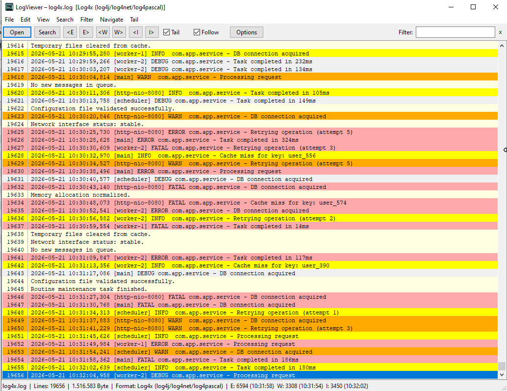
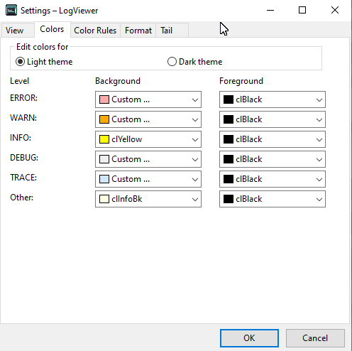

# WLX LogViewer (64-bit) for Total Commander

Fast, feature-rich log viewer plugin for **Total Commander Lister/Quick View**.

This project ports the original `TC\LogViewer` behavior to a **64-bit WLX plugin** and keeps the focus on high performance for very large log files.




# WLX LogViewer (64-bit) for Total Commander

## Highlights

- Native **WLX plugin** (`.wlx64`) for Total Commander
- **No LCL runtime required** (Win32 API based UI)
- Optimized for speed with large files
- Incremental tailing and filtering
- Color-aware log level visualization
- Toolbar, context menu, and options dialog aligned with the original LogViewer workflow

## Core Features

### Viewing & Navigation

- Open logs in **Lister** and **Quick View**
- Jump to:
  - Next/previous `ERROR`
  - Next/previous `WARN`
  - Next/previous `INFO`
  - **Line number**
  - **Date/time**
- Optional **line numbers** with configurable digit width
- Vertical separator line between line number and log text
- **Word wrap** mode

### Search & Filter

- Quick **filter field** in toolbar (right aligned)
- Find support integrated with Lister behavior:
  - `Ctrl+F` / `F7` forwards to Lister search
  - `F3` find next
  - `Shift+F3` find previous
- Context menu actions:
  - `Copy line`
  - `Copy all visible`
  - `Line numbers`
  - `Word wrap`
  - `Go to date/time`
  - `Go to line`

### Tailing

- Live tail mode with configurable interval
- `Follow` mode to stay at end of file
- Optional **“Enable tail when opening file”**
- Non-exclusive file access (compatible with actively written logs)
- Preserves selection/current line while file updates

### Timestamp Synchronization

- The toolbar `Sync` switch joins a viewer to the synchronization group
- Two or more open Lister/Quick View windows in the same Total Commander
  process can participate
- Double-clicking a row in one member selects and centers the nearest timestamp
  in every other member; normal selection and keyboard navigation stay local
- Parsed timestamps are compared as values, so the displayed date/time formats
  may differ
- Time-only logs can synchronize with logs containing full date/time values
- Filtering is respected: matching is performed against the currently visible
  rows in each viewer

### Formats & Parsing

- Auto-detection and forced format support
- Parsing support includes plain logs and CSV-style formats
- Custom format options including delimiter/field-role style mapping
- Correct severity handling from dedicated severity columns (no false override from free text)

### Colors, Themes, and Rules

- Configurable colors for levels (`Error`, `Warn`, `Info`, `Debug`, `Trace`, `Custom`)
- Color preview in options (normal/dark variants)
- **Dark mode control**:
  - Follow Total Commander / automatic
  - Always light
  - Always dark
- Total Commander dark mode is received through `ListSendCommand(lc_newparams)`
  using the `lcp_darkmode` and `lcp_darkmodenative` flags; no polling or
  registry lookup is required for the TC theme state.
- **Color Rules** (pattern-based highlighting) like in original project
- Toggling **Enabled** immediately performs **Update** for the selected rule
  and refreshes its list entry. **OK** saves the changes; **Cancel** discards them.
- In **Options > Color Rules**, enable **Enabled** and **Use level**, choose
  `ERROR`, `WARN`, `INFO`, etc., enter a keyword such as `FAILED`, and click
  **Add** (or **Update** for an existing rule). These rows use the assigned
  level for colors, E/W/I counts and timestamps, and next/previous navigation,
  including filtered views and newly appended tail rows.
- Matching is case-insensitive and accepts substrings. The first matching
  enabled rule wins, including color-only rules. Empty and disabled rules
  are ignored. Without an enabled nonempty **Use level** rule, statistics and
  navigation use the original parsed levels without keyword searches (or
  `Custom` when the user-only option below is enabled).
- Rule matches are cached per row and reused for drawing, filtering and
  navigation; tail updates examine only newly added rows. Editing rules or
  reloading a file invalidates the cache.
- **Use user rules only (disable default levels)** in **Color Rules** ignores
  built-in severity assignments for colors, E/W/I statistics and navigation.
  Only enabled matching rules with **Use level** assign a severity; other
  rows use `Custom`. Color-only rules still apply their colors and retain
  their first-match priority. Timestamps and file-format parsing are preserved.
- This option is off by default, stored as
  `[ColorRules] DisableDefaultLevels=0`. `LogViewer_default.ini` documents
  the settings; it is a reference template and is not loaded by the plugin.

### UI/UX Details

The E/W/I status field measures the actual text in its normal/bold fonts and
scales padding for DPI. Its width updates when counts, timestamps, emphasis,
font or window size change; unchanged text reuses the measured widths. The
statistics take priority over the filename if space is limited. If the entire
window is too narrow, the text is clipped to its field with an ellipsis.

The INI-only setting below controls timestamps in the status statistics:

```ini
[View]
StatusShowDate=1
```

- `1`: `2026-09-30 00:10:00` (plugin default, preserving existing behavior).
- `0`: `00:10:00`. Missing timestamps remain `-` in these two modes.
- `-1`: counters only, e.g. `E: 79  W: 0  I: 1892`, without timestamps or parentheses.

Optional custom status timestamp format (same in WLX and standalone):

```ini
[View]
StatusTimestampFormat=dd.mm.yy hh:nn:ss.zzz
```

- Empty or missing: keep the standard selected by StatusShowDate.
- Nonempty: override the timestamp format for both StatusShowDate=0 and 1.
  StatusShowDate=-1 still hides timestamps and parentheses entirely.
- Pascal FormatDateTime tokens: yy/yyyy = year, m/mm = month, d/dd = day,
  h/hh = hour, n/nn = minute, s/ss = second, zzz = milliseconds.
  Use n/nn for minutes to avoid confusion with months.
- Quote literal text, e.g. `"time" hh:nn`. Do not quote the entire INI value.
  Named months/days and locale separator tokens follow the Windows locale;
  numeric patterns with literal punctuation avoid locale-dependent names.
- Invalid patterns (including unclosed quotes) fall back to the standard.
  Missing timestamps remain `-`. Field widths adapt to the formatted text.

This only changes status text, not parsing, log content or synchronization.
The standalone application supports the same key with default `0`.

- Toolbar with original-style navigation controls
- Status bar with:
  - Lines / bytes / detected format
  - Right-aligned E/W/I stats with timestamps
  - Latest updated class emphasized (bold)
- Consistent normal-weight fonts in toolbar and popup dialogs
- ESC behavior configurable for Lister mode (`CloseOnEscInLister`, default `true`)
- Number keys `1..8` forwarded to Total Commander

## Performance Notes

The plugin is designed for large logs and responsive interaction:

- Raw log text is stored in compact shared buffers
- Fast incremental append path for tail updates
- ASCII fast-path for case-insensitive filtering
- Wrap-height caching and measurement reuse
- Word wrap rendering path focuses work on visible content

## Configuration

Settings are persisted to INI and synchronized across:

- Toolbar state
- Options dialog
- View behavior

This includes line number settings, font settings, wrap mode, theme mode, tail settings, and color rules.

### Theme Settings

The dark mode preference is stored in the INI section `[Theme]`:

```ini
[Theme]
Mode=0
```

Supported values:

- `0` - follow Total Commander / automatic
- `1` - always light
- `2` - always dark

When `Mode=0`, Total Commander actively reports theme changes to the plugin via
`ListSendCommand` with `lc_newparams`. The plugin keeps this state per viewer
window, so multiple open Lister windows can follow TC independently.

## Build

### Requirements

- Lazarus / Free Pascal with Win64 target
- Total Commander WLX SDK units (already included in this project)

### Build Command

```powershell
C:\Users\Alexander\lazarus\lazbuild.exe LogViewerPlugin.lpi
```

Build output:

- `LogViewer.wlx64`

## Install in Total Commander

1. Open Total Commander configuration for **Plugins > Lister (WLX)**.
2. Add `LogViewer.wlx64`.
3. Associate it with desired extensions (e.g. `.log`, `.txt`, `.csv`, `.json`) if needed.

## Project Structure

- `LogViewerPlugin.lpr` - plugin entry point
- `uWLXExports.pas` - exported WLX API functions
- `uWin32LogWindow.pas` - main viewer window, UI, rendering, interaction
- `uLogLoader.pas` - fast file loading
- `uLogParser.pas` - line parsing and format logic
- `uLogModel.pas` - in-memory log storage
- `uLogFilter.pas` - filter operations
- `uPluginOptions.pas` - options dialog
- `uSettings.pas` - settings/INI handling

## Compatibility

- Target: **Windows x64**
- Plugin type: **WLX (Lister)**
- Host: **Total Commander 64-bit**
